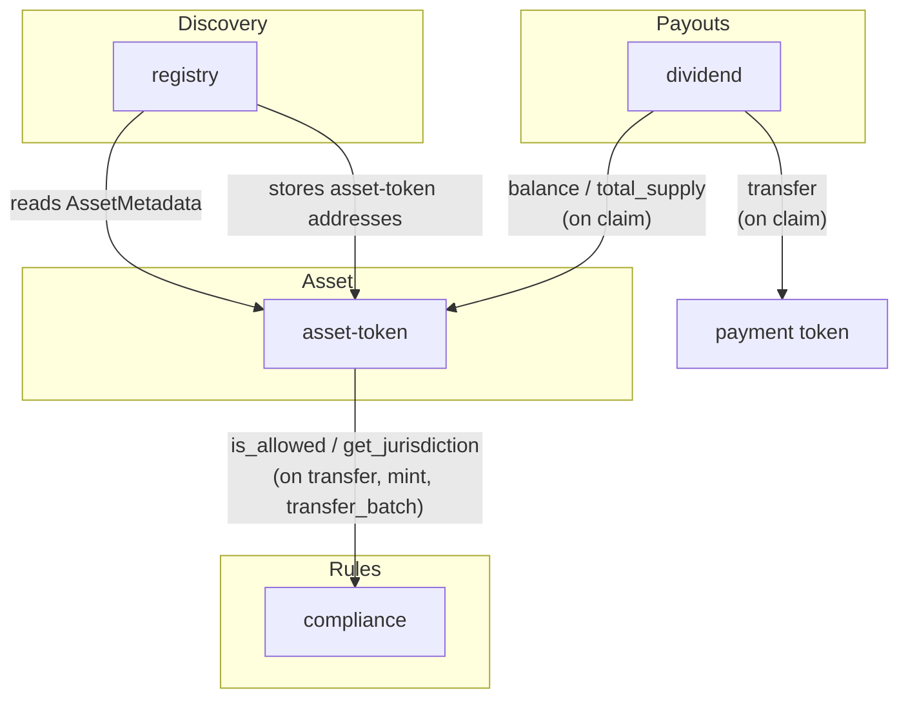

# Architecture

This document gives a single, high-level view of how the four contracts in this
repository relate to one another. For per-contract detail, see:

- [asset-token.md](./asset-token.md)
- [compliance.md](./compliance.md)
- [dividend.md](./dividend.md)
- [registry.md](./registry.md)

## System overview

The system is composed of four contracts:

- **asset-token** — the tokenized asset. Enforces compliance on every transfer
  and mint by calling into the compliance contract.
- **compliance** — the source of truth for KYC / jurisdiction rules. Answers
  `is_allowed` and `get_jurisdiction` queries.
- **dividend** — distributes payments to token holders. Reads balances and total
  supply from the asset-token and moves the payment token on claim.
- **registry** — the discovery layer. Stores asset-token addresses and exposes
  `AssetMetadata` so integrators can find and describe tokens.

## Cross-contract call diagram



### ASCII fallback

```
                 +-----------+
                 | registry  |  (discovery layer)
                 +-----------+
                   |       ^
   stores address  |       |  reads AssetMetadata
                   v       |
                 +-----------+
                 |asset-token|
                 +-----------+
                   |       ^
   is_allowed /    |       |  balance / total_supply
   get_jurisdiction|       |  (on claim)
   (transfer/mint/ |       |
    transfer_batch)|       |
                   v       |
                 +-----------+        transfer        +---------------+
                 |compliance |                        | payment token |
                 +-----------+                        +---------------+
                                                            ^
                                                            |
                                                        +-----------+
                                                        | dividend  |
                                                        +-----------+
```

## Call relationships

| Caller      | Callee        | Function(s)                                   | Trigger                                   |
|-------------|---------------|-----------------------------------------------|-------------------------------------------|
| asset-token | compliance    | `is_allowed`, `get_jurisdiction`              | `transfer`, `mint`, `transfer_batch`      |
| dividend    | asset-token   | `balance`, `total_supply`                     | `claim`                                   |
| dividend    | payment token | `transfer`                                    | `claim`                                   |
| registry    | asset-token   | stores asset-token addresses                  | registration / discovery                  |
| registry    | asset-token   | reads `AssetMetadata`                         | metadata lookup                           |

## Notes

- **compliance** is the single source of truth for KYC and jurisdiction rules.
  The asset-token never makes an allow/deny decision on its own; it always
  delegates to compliance.
- **registry** is purely a discovery layer. It does not gate transfers; it
  records which asset-token addresses exist and surfaces their `AssetMetadata`.
- **dividend** depends on the asset-token for holder balances and total supply,
  and on the payment token to actually move funds when a holder claims.